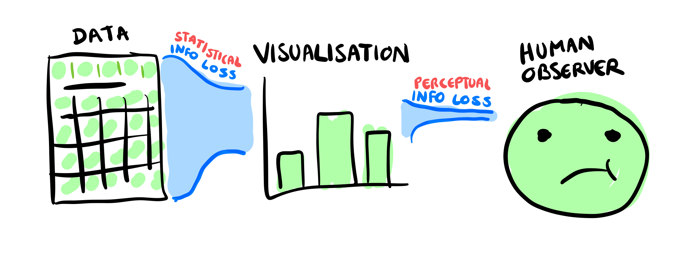
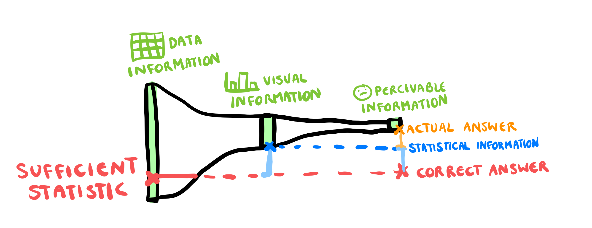
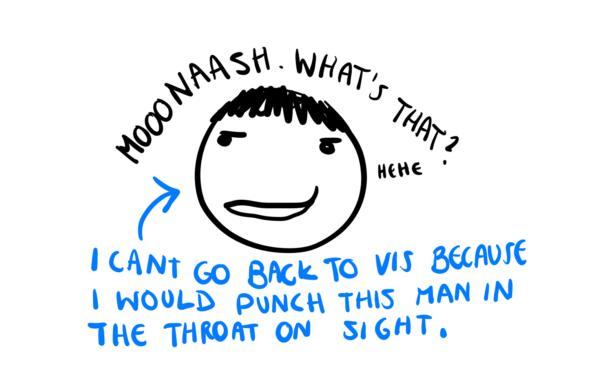
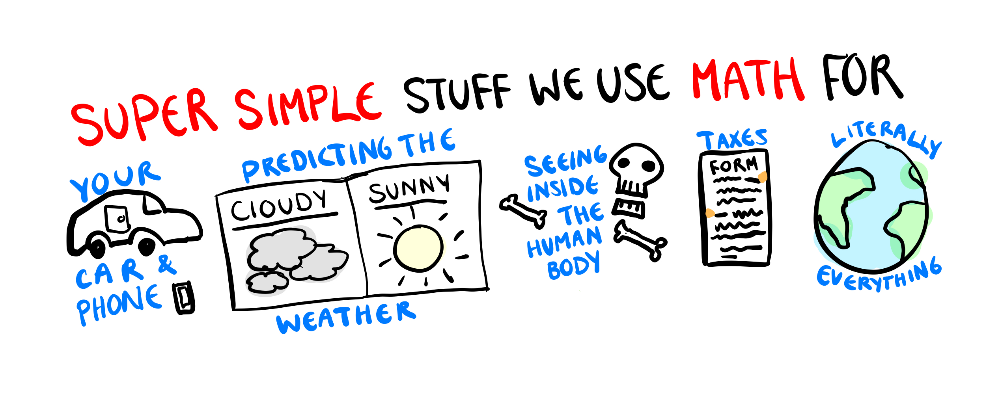
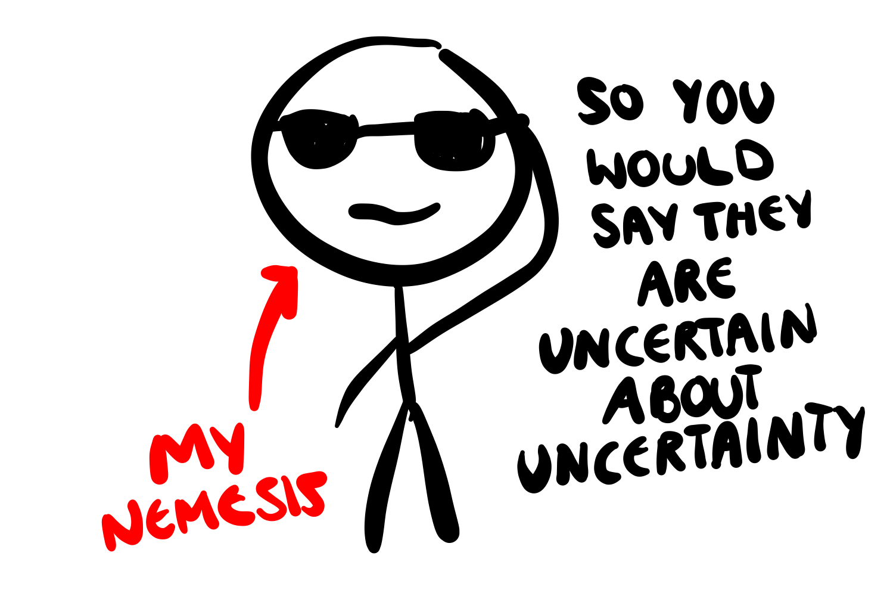

I know the title is provocative, but hear me out; I say this as someone who has dabbled in a bit of crackpottery myself.
Usually I keep my unpopular opinions to myself, but I feel this one might actually offer value.
Mostly because I have, once again, read an opinion piece by a senior VIS researcher who is crashing out about the lack of a formal theory in VIS and complaining about the fact that everyone is just kind of doing stuff.
For examples of what I am talking about, see [this paper](https://arxiv.org/abs/2109.12975), [this paper](https://www.mjskay.com/papers/against-vis-tasks-abstract-2026.pdf), and [literally last year's keynote for IEEE VIS](https://pr.ieeevis.org/year/2025/info/invited-speakers/keynote-speaker?utm_source=chatgpt.com).

I want to hedge this by saying that my main areas are visual inference, uncertainty visualisation, visualisation information theory, and statistics.
I understand this is a small piece of the VIS area (although that in and of itself is part of the problem).
So, if you are reading this, and you are thinking "well this doesn't happen in MY VIS area" then I'm happy for you.
There are many VIS fields with consistent epistemic principles, and if that applies to your field, you may go on your merry way.

## I promise I am not a hater
My point here is not to suggest that all of VIS research is worthless garbage (I mean, it wouldn't make sense for me to publish one of my papers at VIS if this was the case). 
TO really show that I am not a hater, I want to start by mentioning some VIS papers that I really liked.
You can skip this if you are already assured of my hater (or non-hater) status.

- I think the [product plots](https://ieeexplore.ieee.org/abstract/document/6064987?casa_token=I2UeFj1_oecAAAAA:MyzI_SXyAORuUvTMUti9q-go1KL4tf-T3hegJe3ZhfjEdCl5_awv-LtFeTJBwNpKkyjDhC-0sard) use of measure theory to connect the geometry and probability of graphics is neat.
- I think [ggdist](https://ieeexplore.ieee.org/abstract/document/10297592?casa_token=X-mkja9b_aAAAAAA:9gVyyzUXm8jAmZKiggSpDFAzJAEozvIpozga19mUFtrYH5eeFnMDHcnDkDKeQDMKKushFSjSw5dZ) is a nice description of mark design for univariate distributions.
- I also liked the way [Rainbow Colormaps Are Not All Bad](https://ieeexplore.ieee.org/document/10128890) and [The Risks of Ranking](https://dl.acm.org/doi/abs/10.1109/TVCG.2022.3226463) reinvestigated widely held beliefs about plot design
- I think utilising grid lines to try and fix the sine illusion in [Gridlines Mitigate Sine Illusion in Line Charts](https://dl.acm.org/doi/abs/10.1109/TVCG.2022.3226463) is a really interesting way to utilise of what we would have previously considered "chart junk"
- I am a big fan of inattentional blindness research (I used to be into behavioural economics so this was a shock to me), so I thought the [Jurrasic Mark](https://ieeexplore.ieee.org/document/9623273/) paper was so clever, especially because shows the danger of a task/inference based approach.
- The grammar of graphics says that bar charts should only really be used to show a sum, so I like that [Visual Sedimentation](https://ieeexplore.ieee.org/document/6634152/) finds that perceptual research actually backs that up.
- I think [Attention and Visual Memory in Visualization  and Computer Graphics](https://ieeexplore.ieee.org/document/5963660) is is an interesting discussion about how we read plots (that feels better aligned with exploration than some task based research)
- I have always thought tests into the seperability of marks, such as [Measuring the Separability of Shape, Size, and Color in Scatterplots](https://dl.acm.org/doi/10.1145/3290605.3300899) is really important because many of us (or at least many statisticians) treat them as independent axis.
- Similar to the separability work, I really enjoyed this paper, [Perceptually Uniform Construction of Illustrative Textures](https://dl.acm.org/doi/abs/10.1109/TVCG.2023.3326574) when I saw it as IEEE VIS 2023. The idea that something we map in VIS is actually two different aesthetics that can curve around (i.e. they have that horseshoe shape) is deeply fascinating to me.
- I like the recursive structure suggested by [gofish](https://ieeexplore.ieee.org/abstract/document/11274318/) and I think it identifies a real fundamental property in the structure of charts that we don't really talk about. 
- In general the findings in this [Uncertainty in Science is Malleable](https://dl.acm.org/doi/10.1145/3706598.3713972) paper were about what I would expect BUT this paper has the single greatest line I have ever read in a paper and I think about it at least once a week: *"After numerous design and implementation iterations for visualization glyphs, our visualization system shows, by default, the uncertainty measures using simply a size encoding. After two years of work, did we simply create a visualization with a set of filters and a representation of uncertainty using size?"*. I LOVE the honesty from the authors here, and I am so glad that VIS has a culture that let them keep that sentence in. 

*NOTE: I will add to this list if I remember or see papers that I really like - and am still updating this post. This is not a complete list, there are other papers I like, but I don't have all day, people. *

## My personal experience at IEEE VIS 2023
Around the start of the second year of my PhD, I was quite involved in the VIS community.
Most of my Zotero was filled with IEEE TVCG papers; I picked VIS papers for my research discussions; and I went to VIS 2023 in Melbourne, where I presented an early version of my PhD research as a poster. 
At this point, my supervisors, who were more statisticians than VIS researchers, were not really keen on my work, but they couldn't really explain to me what was wrong with it.
I was working on a taxonomy that described the information of uncertainty visualisations.
From my perspective, my research was quite similar to the research I enjoyed reading in VIS conference proceedings and journals, so I didn’t see what was wrong with it.
However, while at VIS in 2023, I started to understand my supervisors' perspectives and develop some concerns of my own.

Now, I need to give a little context for the issues I ran into at VIS 2023.
By training, I am a statistician (with a little bit of economics). 
That is to say, I approach graphics from a statistical theory perspective.
However, I actually think this is a strength for one key reason: **data visualisations are literally summaries of data. They are therefore statistics, and their information theory falls under the purview of statistics.**
The only people who I have found to disagree with this statement are those who want to work on statistical graphics, but are uninterested in learning any statistics, which is going to be an ongoing issue in this post.
This drawing is the best explanation I can give for how information *must* travel in a visual inference task (like it is literally just the fundamental concept of information theory).

This is a very straightforward point: I cannot visualise information that is not in my data, and I cannot see information that is not visualised. 
At best, the information passing between layers can be equivalent to the stage before, but never more.
So the potential amount of information in the visualisation should follow this principle: $data \subseteq visualisation \subseteq observer$.
If we ask someone to perform a specific task, we are indirectly asking them to compute a statistic, $\omega$, which will have an associated **sufficient statistic**.
A sufficient statistic is a function of a sample that captures all the information about $\omega$.
Therefore, at the very minimum, for a participant to correctly answer a question about a graphic, the graphic *must* contain (in some form) the sufficient statistic.
If you show someone a graphic which does not contain sufficient statistical information it is mathematically impossible to answer the question correctly. 
No amount of human perception studies will change this fact.

Why is this relevant to VIS 2023? 
Well, at VIS, I noticed several talks in which the authors compared two different plots on a single task. 
However, in one plot, the sufficient statistic was intact, while in the other, it had been destroyed.
The information required to answer their question was gone before any human looked at the plot.
We didn't need a perceptual experiment to work that out.
Additionally, I started to find that *computational distance to the sufficient statistic* was a near-perfect predictor of every single task-based experiment.
Because the authors did not consider the statistical information in the plot, they were constantly attributing the statistical information loss to the human observer, with statements like "our results show that people are unable to extract the mean from a boxplot".

So, since it's a conference, and I am a young and enthusiastic PhD student, I decided to try and talk to some of the authors about this observation. 
I am not an *animal* so I didn't raise my "it's more of a comment than a question" during Q&A, but I did stop the authors after their session to discuss how sufficient statistics could inform their stimuli design.
To say that the responses I got from VIS academics were overwhelmingly rude and dismissive is an understatement.  
One author stared at me, didn't answer my question, looked at my name badge, and said with a southern drawl "Mooonaaaaash University" before sniggering and saying "where even is that?" and then turning away to talk to someone else.
Another attendee said I was "trying to use statistics to gatekeep visualisation research" and asking people to check if their plot had sufficient statistical information was "an unfair burden to put on VIS researchers".
Another academic said that, as an “expert”, I might read plots that way, “but VIS is interested in understanding how the average person reads plots”, so my theory of information was not useful.

While the rudeness was certainly a problem, the thing that was more concerning to me was the way that everyone was acting as though I had shared an opinion, rather than a **mathematical fact**.
To me, ignoring sufficient statistics in VIS felt like a statistician ignoring the fact that 1+1=2. 
The entire experience was bizarre, and ultimately soured my attitude to the VIS for the rest of my PhD.

## Oh no, am I doing crackpot science?

It was around this time that I saw [this video](https://www.youtube.com/watch?v=11lPhMSulSU) (and also [this video](https://www.youtube.com/watch?v=aY985qzn7oI)) on crackpot science.
The video suggests four markers of a crackpot theory:

1. The work addresses the biggest problems in the field
2. It is lacking in mathematical rigor, experimental evidence, etc.
3. When their ideas are rejected, they respond with anger and claim the scientific establishment has blacklisted them
4. The theories are not recognisable as theories for that field. 

Upon seeing this list, I realised why my supervisors (and panel) were not fans of my research.
My PhD work had a lot of the markers of a crackpot theory.
To translate the crackpot theory to the context of my particular research question, the issue was that:

1. Trying to describe the information theory of uncertainty visualisation was way too vague and broad. In an effort to be generalisable and far-reaching, the theory said nothing.
2. By using a taxonomy, I was avoiding mathematical rigor, and designing a theory that was not verifiable or testable in any capacity.
3. I was not being receptive to my supervisors concerns about the research.
4. I was not using the established language or theories of statistics, so my research was not recognisable as a statistics theory.

Now, I wasn't running around screaming about being Einstein (that would come later), but there were enough similarities that I started looking more critically at my research.
After all, if I really believed my work was different to crackpot shit, I shouldn't be averse to proving it.
It turns out, proving it was much harder than just offering a vague taxonomy, but it also made the work more valuable.
Through the mathematical formalisation, my theory went from a vague idea to something that could be tested and falsified (if wrong).
What was involved in this process? Specifically I had to:

1. Drop the taxonomy approach and [formalise my ideas in mathematical statistics](https://www.tandfonline.com/doi/full/10.1080/10618600.2026.2759709), which required me to: *(a)* Argue that visualisations should be considered continuous functions from the data space to the visual space. *(b)* Define a metric for the visual space, which can be used to define the space of visual graphics as a metric space. *(c)* Use the metric space to define convergence of statistical graphics. *(d)* Use convergence to translate continuous mapping theorem to uncertainty visualisations and show their ideal behaviour.
    
2. [Translate this formal theory into a testable hypothesis](https://www.annualreviews.org/content/journals/10.1146/annurev-statistics-042825-110607) that could predict the outcome of an experiment and be falsified by a negative result. A consequence of the mathematical formalisation is that a visual signal should be harder to see as the uncertainty increases. 

3. [Actually test this hypothesis](https://ieeevis.org/year/2026/program/content/999293ca-3366-4953-8aaa-a7d59a0159ad/) with a proper human experiment.
    
At every stage, I asked myself what a crackpot would do, and then tried to make sure I did the opposite.
Ultimately, this approach had the extra benefit of leading to a flexible and generalised uncertainty visualisation system that can make an uncertain version of any plot, called [`ggdibbler`](https://github.com/harriet-mason/ggdibbler).
A result which is clearly of interest to the VIS community, since two papers from this year - i.e. [1](https://ieeevis.org/year/2026/program/content/88ac885c-eced-46ef-80ce-ca8a1dacad1a/) and [2](https://ieeevis.org/year/2026/program/content/87e9069f-c5dd-411a-9cbf-5730077c7a18/) - are a subset of what can be done with this theory and software.

## OK hear me out, I think VIS has a little bit of crackpot stuff too

When I started applying the "crackpot checklist" to my research, I started getting more interest from statisticians and less interest from VIS.
Unlike the VIS community who were overwhelmingly dismissive of my comments about mathematical rigor, statisticians were enthusiastic about it.
[Some might argue](https://bsky.app/profile/mjskay.com/post/3mzuh2rv6ys2a) that I am being pedantic about the distinction between statistical graphics and VIS, but I would disagree.
To start with, nobody in statistics has called me a gatekeeper who went to a shit university (well, not yet).
But the other main differences are that (1) statistical graphics builds on a well-established theoretical foundation (statistics), and (2) the primary reviewers for statistical graphics papers are statisticians who can tell if there is something wrong with the statistical logic. 
If you ignore these differences, you end up with something that starts to look a LITTLE bit like crackpot science.
So, lets look at that crackpot list again and discuss each one in relation to VIS (ignoring #3 because we are talking about a whole field).

**But before that, I need to give a CLARIFICATION!**
These examples are not about these authors or their work in particular.
You will notice that many authors appear in both the papers I love that were mentioned at the top of the post, and the papers with some questionable decisions (listed below). 
I mean, I even have a few papers I could split in half into the love and hate category.
So, the point of this is not to say that I think these authors, or their work, are "crackpot".
Rather within VIS this is all perfectly good research, which is exactly my point.
VIS is not suffering from a handful of crackpot researchers, I think the culture in the field itself promotes the *exact* qualities (big ideas, vagueness, bespoke methods, etc.) that other fields would consider to be somewhat *crackpot*. 

#### 1. The work addresses the biggest problems in the field

How does VIS view themselves as a field?
Well, we can get a gist from [this bluesky comment](https://bsky.app/profile/mjskay.com/post/3mzugh56tvc2a) where I was told that "the correct project for VIS is not checking data formalisms against human interpretation, but building up models of how people read charts that combine those data formalisms with perceptual and cognitive operators".

**(Correction: [Matt said](https://bsky.app/profile/mjskay.com/post/3n26lhggss22a) I misunderstood his comment and he is pro maths formalism and specifics (previously this section had comments on maths formalism). Sorry Matt, my bad. The following section is, from my understanding, not in disagreement with Matt's comment.)**

**(Correction 2: I previously said Tamara Munzner agreed with Matt's point because she liked the post, but [she has clarified](https://bsky.app/profile/munzner.bsky.social/post/3n26udbxaek2e) that she does NOT endorse Matt's anti task rant )**

In conversations, I have noticed a little animosity to the idea of limiting the scope of the VIS.
I think a lot of VIS researchers see VIS as a melting pot of a field where they are coming up with a true "theory of visualisation" that can cover everything that visualisation touches. 
Therefore, the breadth of visualisation is a strength, after all it allows them to take the best ideas from multiple fields, including statistics, computer science, and human psychology.

The problem with this idea, is that it is a bit of a fantasy. 
When you make a field *so* broad that it involves everyone, people who do work that is tedious and time-consuming end up outnumbered and ejected from the community.
This is the case for statisticians whose field moves slower, so they publish far fewer articles than the average VIS researcher.
I rarely come across a formally trained statisticians in VIS, the vast majority of people doing "statistical graphics" in VIS are computer scientists who do not have a large amount of statistical training.
This is not a bad thing, I have seen people from all fields, including linguistics, biology, and music do great statistics research.
The problem is that these people do statistics in a field of statisticians who can check the correctness of the work.

Having such a broad range of domains means that authors with the expertise required to review a paper is few and far between.
This is especially bad when you have the pace difference between the fields as decribed above.
I often find myself outnumbered (on both sides of the reviewer-reviee relationship) when I try and correct incorrect statistical reasoning.
I have found this to be anecdotally true as I know several statisticians, who have also had their comments shrugged off and treated as a "difference of opinion" rather than a self-evident statistical fact.

This leads me to wonder if the openness at VIS not only prevents the idealised "melting pot" community, but also the persuit of it leads to a reduction in the quality of re.

#### 2. It is lacking in mathematical rigor, experimental evidence, etc.
I have noticed a bit of an aversion to mathematical rigor at VIS (see story above).
One thing I find quite odd about this response is that it implies that math is some kind of limitation on the field that would reduce the number or flexibility of the theories. 
I mean, I would hardly describe the fields within the purview of math, such as the physics of the entire universe, predicting the weather, and describing the economy, to be simple or trivial research.
The idea that computer graphics is the one field that is too complicated for math to capture feels a little absurd to me.

This aversion to formalism leads to what I would call a "statistics slop" issue in VIS.
These are papers that have statistical arguments that have the *sheen* of statistics, but the statistical reasoning is often built on confusing or questionable assumptions, and/or disconnected from standard statistical theory. 
All the calculations in these papers are often correct, with a logical flow, and they look just like what we would see in a statistics textbook, so on face value, there is no problem. 
However these papers often fail what I would call the "statistics sniff test".
They are, what some academics might call, "not even wrong".
  
Before I give some examples of what I am talking about, I want to make it clear that the *authors of these papers are not to blame for this*. 
As a matter of fact, to make this point clear, I want you to read the explanation as to why these papers have incorrect statistical logic and see if you, as a VIS researcher, would have clocked it.
These are going to focus on uncertainty visualisation (that is my specific area of expertise and also where statistical reasoning is most relevant) but I have noticed similar issues in papers outside this specific literature.
With that being said, here are some examples of the issues I'm talking about:

- The [MapLineup paper](https://ieeexplore.ieee.org/abstract/document/7539286?casa_token=huSInJnxmp8AAAAA:xSuEnAW-Oiqvqpj_EZz5AXpwwbf6bJDOLncUw7sZOzfivRMbn3Jqdcuv6_X35ta9qqiJaiM8uPsa) paper, which criticises the lineup protocol, and suggests a different method to measure JND. This paper seems to have been was entirely borne from the authors misunderstanding about the fact that a lineup protocols must has a random null plot with no structure. Actually a lineup can have any null distribution you want. I don't understand why the authors seem to think that spatial autocorrelation in the null would require a different method. They do not provide any justification for this in the paper. 

- This [Evaluating the Use of Uncertainty Visualisations for Imputations of Data Missing At Random in Scatterplots](https://ieeexplore.ieee.org/document/9904433) paper, which is visualising imputed missing random values, using things like confidence intervals or density plots. The confidence intervals are calculated using using the sampling distribution associated with the mean imputation. The proper confidence intervals for the missing values would have been the prediction intervals (which would be far wider than the intervals used in this visualisation). This is because the no-imputation case, is not conditional on the imputation, so by making the confidence intervals dependent on the mean imputation, these plots have two different "ground truth" values. Other than this issue, the statistics in this paper is totally correct (at least on my pass, but I don't know everything, lol) and since the statistical error is quite subtle, I actually think this one is one of the better ones (and it would pass review at a statistics journal). I thought the experiment was well designed otherwise, and would have been interested in the results of this paper, especially if compared to the “in the gutter” approach from the [`naniar`](https://naniar.njtierney.com/) package. *Note: This version incorperates parts of Abhraneel's rebuttal, which can be found [here](https://bsky.app/profile/abhsarma.bsky.social/post/3n27y6deh5c2e)*.

- The [value suppressing uncertainty palette paper](https://dl.acm.org/doi/10.1145/3173574.3174216) which suggests suggests a 2D palette, which blends colours together as they become more uncertainty.  The problem with this, is that really isn't a sensible way to represent a distribution as a single colour, so there isn't a statistically sensible way to blend the colours together. You could say it should align with some sort of hypothesis test, but hypothesis tests often don't agree. For example, if we consider three values, each of them might pass a paired t-test, so they should be the same colour, but fail an f-test, indicating that they shouldn't be the same colour. How do you set the scale such that this works? You can't. This issue arises from the fact that this mean/variance approach is a fundamental mischaracterisation of what a random variable is.

- The [Effects of ensemble and summary displays on interpretations of geospatial uncertainty data](https://link.springer.com/article/10.1186/s41235-017-0076-1). This one is NOT a VIS paper, but it includes some VIS authors, and it is foundational work for uncertainty VIS, so I have included it here. The paper consists of several experiments that assess different approaches for visualising storm uncertainty. Experiment 1 and 2 have conflicting assumptions, which are not acknowledged by the authors, and make for a confusing read. The first experiment sets the ground truth on the assumption that the storm intensity is unrelated to the distance to the center of the distrbution, the third experiment assumes the opposite. I have read this paper three times, and I cannot see another way to interpret this study. (This has driven me insane for years, so if someone can explain what is happening here I would love to find out that I am wrong.) *HOWEVER* this paper isn't all bad. The finding that people think an event is more probable if it lands directly on a simulated outcome is *very* interesting (and the statistical reasoning is correct).

- The [Fitting Bell Curves to Data Distributions  Using Visualization](https://ieeexplore.ieee.org/document/9905944) paper asks people to fit a bell curve to a boxplot, histogram, dotplot, and stripline plot. These plots have wildly different statistical information with very little justification linking them. There are also questions about when plots of different resolutions can be compared (but expecting people to understand how resolution affects bias would be beyond completely unreasonable on my part).

- The [How Visualizing Inferential Uncertainty Can Mislead Readers About Treatment Effects in Scientific Results](https://dl.acm.org/doi/10.1145/3313831.3376454) paper compares people's sense of uncertainty when shown confidence and prediction intervals. This one is.... confusing to me to say the least. Yes, you will have smaller uncertainty bands when you have a confidence interval. Yes, most people do not know the difference between a confidence interval and a prediction interval. There isn't a way to compare the the two intervals on an inference question that wouldn't favour one of the plots. The paper seems to be built on the assumption that you can, or should be able to in some capacity? In this specific case, the participants were making a judgment on a new game outcome, so I think the prediction interval is the correct distribution (but the information to work this out is often hidden away in the methods or appendix of the paper). Given the statistical discrepancy, I cannot wrap my head around the purpose of the human experiment in this paper. This boils down to comparing apples to organges on the basis of which makes better orange juice, and then confirming the results with a human taste test. I also suspect this paper is why I sometimes see VIS papers present a prediction interval (when they should be showing a confidence interval) so that they don't "underreport the uncertainty".

- The [Impact of Vertical Scaling on Normal Probability Density Function Plots](https://ieeexplore.ieee.org/abstract/document/10670477) paper scales individual density functions and checks it's impact on the human perception. Like the imputed missing values paper, this paper isn't particularly ergrigious, but the assumptions of the paper are so alien to me, I just had to include it.  Yes, the y-axis on density curves is arbitrary. Yes, it is important to keep the area consistent for if you are comparing distributions (that is the common unit between plots). Yes I understand software allows you to independently scale distributions. The only case where I would scale two distributions differently is if one distribution was so spread out/concentrated it was unreadable, and you are not supposed to compare distributions across independently scaled plots (only within plots). You should never independently scale distributions that are on the same scale. Like the Hofman paper above, I get the impression that the core assumptions required for this paper is the sentiment that "people do statistics wrong". While I accept that this is probably a fair motivation in the VIS literature, I am often confused as to why this is proven with a human perception study. 

- The [Bar graphs depicting averages are perceptually misinterpreted: The within-the-bar bias](https://link.springer.com/article/10.3758/s13423-012-0247-5) again, not a VIS paper, but a lot of VIS papers are related to this, so it is worth mentioning. Bar charts should show a sum. It doesn't make sense to use a bar to show an average as a bar is an interval. This is even explicitly stated by the [*grammar of graphics*](https://link.springer.com/book/10.1007/0-387-28695-0). I am not sure why we need so many human perception studies on the within bar bias and how to correct it, when you shouldn't have used a bar in the first place.

*NOTE: I have added to this list to spead out my criticism and avoid attacking a small handful of authors. I see this as a field level problem, and not due to a few individuals. This is not a complete list and I might update it when I think of papers that should be in this list. If your paper appears in this list and you disagree with my assessment, feel free to post/send me a rebuttal and I will link it to the discussion of your paper.*

What is my point with these examples? 
Well, mathematical rigor extends beyond individual mistakes or calculations, it can also suggest purpose.
As a statistician, people assume you mostly deal with bad answers, but you actually spend almost all of your time on bad questions. 
A bad answer is something like an incorrect statistical model, or maybe a failure to account for assumption violations (like missing values or heteroskedasticity).
These issues are often trivial.
A bad question is a different issue entirely.
Bad questions are vague in what they want, can't decide how to measure it, and have competing, conflicting, assumptions. 
When I look at these papers with their bizzare assumptions, confusing distribution choices, and inability to define what they are even trying to test, I do not see a field with bad answers, I see a field with bad questions. 
The process of defining an idea mathematically allows you to clear up these problems.
What do you mean when you say "best"? Do you mean easiest to interpret? Easiest to make? The one with the most information? 
The mathematical definition of your goal goes back to your core beliefs about what it is the field is trying to do.
What does "best" mean to you?
If ten papers that all find the "best" design, each have their own definition of best, rooted in completely different views for the field, they will never coalesce into a single cohesive theory.
You are doomed to painstakingly troll through the methods and appendix (as I had to do for the papers above), to work out what this papers definition of "best" is.
We are not liberated by the avoidance of mathematical specifics, we are shackled by it.

These problems are not limited to the statistical arguments either.
Theoretical papers in VIS present ideas for how visualisations are made or used, but are often incredibly vague, and use their own bespoke terminology/symbols and are impossible to translate into the mathematical formalisation required to actually test it.
The correctness of these papers seems to be based on how real they "feel", with the epistemics of the area having more in common with a religion than a science. 
The most famous version of one of these papers I can think of is a [nested model for visualisation](https://ieeexplore.ieee.org/abstract/document/5290695) (no hate to Tamara though, this is just the main one that always comes to mind).
Because of this, the large majority of experimental work do not actually test these "theories" of VIS directly.
Instead, they test:

- their own mathematical approximation of the vague theoretical concept, which is often translated differently by each researcher (for an example see the "decision making" literature)
- theories from other fields (such as vision science or statistics), or
- their own bespoke theory invented for the particular paper.

This leaves the empirical and theoretical work of VIS completely disconnected from one another.
Ultimately, VIS is not left with many papers that offer a (correct) theoretical foundation that can be empirically tested.

#### 4. The theories are not recognisable

The disconnect between the empirical and theoretical work at VIS often makes it feel like people are just taking turns saying stuff.
However, VIS is not only disconnected from it's own theories, it is also disconnected from the theories of other fields.
I am not an expert in everything, so I can't speak to every field, however, I am an expert in statistics.

This is all to say, some of the terminology and ideas used by the uncertainty visualisation community are somewhat bizarre.
Many of the authors in uncetainty visualisation don't really seem to know what uncertainty is (which makes their decision to research uncertainty visualisation a little odd if I'm going to be honest). 
Uncertainty is the by-product of inference, this is just a [fact of statistics philosophy](https://www.annualreviews.org/content/journals/10.1146/annurev-statistics-042825-110607) and a lot of science philosophy more broadly.
Since uncertainty is the by-product of inference it is always connected to some inferential statistic.
This means you need to be drawing inference on *something* for there to be any uncertainty.
Additionally, the uncertainty is limited to that one statistic.
However, a lot of uncertainty visualisations papers treat uncertainty as a *vibe* or something that erupted from a nebulous void (e.g.  [1](https://ieeexplore.ieee.org/document/6327283/), [2](https://ieeexplore.ieee.org/abstract/document/10292709)). 
Alternatively they think that uncertainty distributions on different estimates are freely exchangeable (e.g. [1](https://ieeexplore.ieee.org/document/9904433), [2](https://dl.acm.org/doi/abs/10.1145/3313831.3376454)).
Or they are bizarrely specific and link the quantification of uncertainty to it's visualisation approach (e.g. [1](https://ieeevis.org/year/2026/program/content/88ac885c-eced-46ef-80ce-ca8a1dacad1a/) and [2](https://ieeevis.org/year/2026/program/content/87e9069f-c5dd-411a-9cbf-5730077c7a18/)), even though they are completely independent statistical concepts and the
[uncertainty should never be quantified inside the visualisation](https://www.annualreviews.org/content/journals/10.1146/annurev-statistics-042825-110607).

There are also a lot of VIS papers that are clearly knocking on the door of some very foundational statistics theories, and they would benefit from the specificity that comes with adopting the norms of statistics.
For example, there are a few papers that give a taxonomy, or design a perceptual test, for what is fundamentally the statistical issue of bias and variance (e.g. [e.g.1](https://ieeexplore.ieee.org/document/11268922), [2](https://ieeexplore.ieee.org/document/8440818), and [3](https://dl.acm.org/doi/10.1145/3313831.3376420)).
There is also [this](https://bsky.app/profile/albertocairo.com/post/3mykgpc5g4c2f) recent bluesky thread which boils down to a discussion about the impact of the conflicting assumptions made by a plot designer and it's viewer, an issue which has a parallel in statistics as [multi-phase inference](https://statistics.fas.harvard.edu/sites/g/files/omnuum10116/files/statistics-2/files/xlm_pastpresentstatsci_537-562_2014.pdf).

## My suggestions to be less (or more, no judgement here) crackpotty
So, to summarise these issues, VIS has a little bit of crackpottery going on.
And look guys, I get it. 
I have done my fair share of crackpot research.

Ultimately, I think the VIS communities greatest strength is also its biggest weakness, and that is its openness to new ideas that are not (and may never be) fully formed or testable. 
This openness is what is causing the lack of rigor that has you people crashing out about the field being directionless (see [e.g.1](https://arxiv.org/abs/2109.12975) and [e.g.2](https://www.mjskay.com/papers/against-vis-tasks-abstract-2026.pdf)).
VIS can't be desperate for rigor, and then be hostile to rigor itself. 
So I think its worthwhile to maybe evaluate the openness of the community, and ask yourself if it is always a good thing.
When I think about what it is we are trying to do in science, I often think of this quote by Henri Poincaré:

> "Science is built up of facts, as a house is built of stones; but an accumulation of facts is no more a science than a heap of stones is a house."

I often find that, in VIS research, a paper will offer their own bespoke validation of their own bespoke theory.
They will toss away an existing house because their brick does not fit in.
At the end of the day, you are left looking at a pile of stones, and nobody seems to be building a house.
I think (or god, hope) that VIS can be more than this, so I implore the researchers to start thinking about the kind of research that helps to build a house.

In statistics, it is my job to write my theories/arguments *that start from the existing literature*. 
If I disagree, I need to (convincingly) explain why, otherwise, I need to build on top of the existing theories.
This puts a larger burden on the author, as they must cut and shape their ideas so their brick fits into the existing structure of the house. 
[This comment](https://bsky.app/profile/kalealex.bsky.social/post/3n2bvkif7ac2x) makes me wonder if the celebration of individualism in VIS is also inhibiting cohesive research.
Good science is a collaborative effort, and collaboration in science, just as in life, means limiting our individual freedoms.
The same is true for software design (a point I think is made quite well by [this comment](https://bsky.app/profile/story645.bsky.social/post/3n27fhenzxs2s)).

You might read my post, which asks you to cut your stones so they fit in the house, and see it as an affront to the boundary pushing freedom of academic work.
But I ask you not to read this from the perspective of an *author* but from the perspective of a *reader*.
The reader who you have given a pile of stones, many of which do not fit together, many of which *cannot* fit together even they are presented as though they fit together, and you have told this reader to build a house.

There is a trade off in how accessible your field is to a reader or viewer, to stone maker and house constructor.
Do you overburden the reader and force them to spend years navigating conflicting literature (with conversations that are so independent the literature doesn't acknowledge this conflict)?
Are the readers each burdened to build their own house (exacerbating the problem where the field has no common theory)?
Or, do you start putting some of the burden on the authors, and ask them to shape their work into something that talks to the existing literature?

Ultimately, from my perspective, the VIS literature (specifically the sub-areas I am adjacent to) either need to:

a. Stop being so loosy-goosy with what you consider to be research, and start asking for properly defined, and testable theories, or
b. Fully lean into the openness of everything and anything being research and accept the fact that the literature will not be cohesive, and there will not be a house.

If you want to stop being so loosy goosy, then you need to start formalising your ideas.
I don't care how you do it, use statistics, psychology, information theory, anything would work, but for the love of god, make it something *I can use when I need to build an extension on the house*. 
Personally, I would prefer you formalise it in statistics, given the information theory issue I raised above (you can't perceive information or data that isnt there).
Plus, I have seen a few papers that identify a "human" bias, which is actually a statistical bias, so setting a foundation in statistics (at least for data visualisations) would (hopefully) stop that from happening.

A formal theory will not ruin your field.
Like, "fields that have a mathematically defined theory that they test" is basically all of science, including fields like physics, economics, and meteorology.
I'm not even saying you need formulas, I'm saying *be specific enough that it can be tested or discredited*.
Its not even the bad stuff, really clever experiments are some of the best thing science had to offer.
I'm not even saying you can't do both the theory and the experiment.
The theory just needs to be sent to a venue that has the expertise to assess it. 
If this blog post is evidence of anything, it is evidence that the VIS community *clearly* cannot be trusted to do their own statistics (no offence).

Or don't, and just keep doing what you guys are doing. 
I don't really care.
We all do a little crackpot science.

## P.S. the rebuttal & comments
This post generated quite a bit of online discussion, which quickly became difficult to navigate as the replies stacked up.
As a firm believer in the merits of academic debate, I think it is important that I platform the rebuttals to this post (of which there were many).
Here I link the responses to this post, so you, the reader, may engage with the wider discourse and come to your own conclusions about the merit of the criticism that I levy against the VIS literature.
Keep in mind, I update this post to clarify points as the confusions come to my attention.
If you are reading this blog post later, and think that it makes a strong point, you, in large part, these rebuttals to thank for that.  
I will also add examples to the VIS papers I love, and statistics mistakes to share the love (and hate) wider to avoid individual people feeling attacked or unfairly elevated above their peers.

First, comments from three people I would broadly consider to be statisticians (we are not a monolith, so it is only fair to illustrate that they all don't agree with me):

- [Keigan Rice](https://bsky.app/profile/kiegan.bsky.social/post/3n27wl4nww227)
- [Cynthia Huang](https://bsky.app/profile/cynthiahqy.bsky.social/post/3n26fmaf3ec2z) (+ comments from Jonatan Hildén)
- [Joyce Robbins](https://bsky.app/profile/jtrnyc.bsky.social/post/3n2bqdbpqd22s) (who just have positive vibes)

Then a lot of good points from VIS researchers that are worth reading (this list is in no particular oder):

- [Alex Kale](https://bsky.app/profile/kalealex.bsky.social/post/3n26pjxb66c2b) who had a lot of interesting and insightful comments on this discussion but they are kind of everywhere, and I can't find all of them. This thread also has the comments from Abhraneel Sarma that were linked earlier in the post.
- [Jonatan Hildén](https://bsky.app/profile/jhilden.bsky.social/post/3n26fhkyits2j)
- [Danielle Szafir](https://bsky.app/profile/danielle-szafir.bsky.social/post/3n2bzcfxca22q) on different frameworks for stats and vis.
- [Matthew Kay](https://bsky.app/profile/mjskay.com/post/3n26lhggss22a) (again linking to his comments - a rebuttal to a previously wrong version of this blog post - that are worth a read) 
- Similarly [Tamara Muzner](https://bsky.app/profile/munzner.bsky.social/post/3n26udbxaek2e) clarification linked earlier in the post (this thread also has some nice comments from Alex Kale and Keegan Rice)
- [Frank Elavsky](https://bsky.app/profile/frank.computer/post/3n2hbrw3a3c2u) who is a believer in friendly criquite - alas, I am not (also, Alex Kale has some really interesting comments in this thread).  
- [Gabriela Molina León](https://bsky.app/profile/gabymlp.bsky.social/post/3n2bfor4ecc2k) clarifying that there are multiple areas of VIS with multiple epistemic approaches
- Dr T.J. Jankun-Kelly, who had a couple of small comments accross [post 1](https://bsky.app/profile/infowantstobeseen.org/post/3n27bulsqyk26), [post 2](https://bsky.app/profile/infowantstobeseen.org/post/3n27bulsqyk26), and a [reply](https://bsky.app/profile/infowantstobeseen.org/post/3n27c574j4226).
- [Hannah](https://bsky.app/profile/story645.bsky.social/post/3n27cbmoqus2s) who asked for a clarification on what I mean by crackpot.
- [Alberto Cairo](https://bsky.app/profile/albertocairo.com/post/3n276zqtlrs2j) (which includes [this reply thread](https://bsky.app/profile/jwolondon.bsky.social/post/3n277qh2chc23) which also has some interesting comments from Jo Wood and Danyel Fisher.
- [Observable](https://bsky.app/profile/observablehq.com/post/3n266wy7r322v)

If you make a rebuttal that you would like me to link, feel free to email me (or tag/message me on Bluesky) so it can be easily accessed here.

